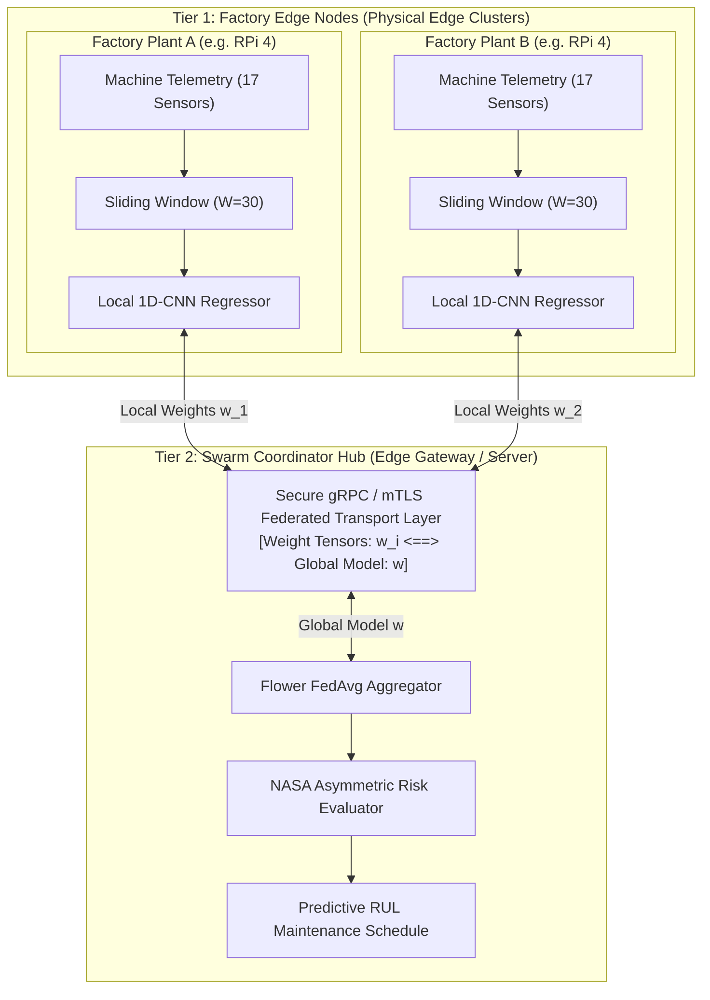

# 🏭 FedPdM-Edge: Swarm Federated Predictive Maintenance for Industry 4.0

[](https://opensource.org/licenses/MIT)
[](https://www.python.org/downloads/)
[](https://pytorch.org/)
[](https://flower.ai/)
[](https://www.interregaurora.eu/)

**FedPdM-Edge** is a privacy-preserving, decentralized predictive maintenance framework developed for industrial manufacturing environments. Built under the **EU Interreg Aurora Project *ResilientEdge*** (Grant No. 20373282) by **Mid Sweden University** and the **University of Oulu**, it addresses the critical challenge of keeping raw machine telemetry strictly on-premise while collaboratively training robust Remaining Useful Life (RUL) regression models across distributed factory sites.

---

## 📌 Context & Problem Statement

In Industry 4.0 manufacturing plants, operational machinery telemetry (turbomachinery vibration, temperatures, pressure, actuator states) represents guarded intellectual property and operational secrets. Streaming high-frequency sensor readings to third-party cloud lakes introduces severe data exfiltration risks and regulatory barriers. 

However, isolated plants frequently encounter data scarcity: rare catastrophic mechanical failures happen infrequently at a single facility, causing locally-trained models to overfit or miss degradation anomalies. 

**FedPdM-Edge** solves this trade-off using **Swarm Intelligence and Federated Learning (Flower + PyTorch 1D-CNN)**:
- **Zero Raw Data Sharing:** Plants exclusively exchange encrypted neural network weights $\mathbf{w}_i^{(t)}$. Raw sensor streams never leave the plant boundary.
- **Asymmetric Risk Optimization:** Evaluated against the exponential **NASA Asymmetric Scoring Function**, penalizing dangerous late failure predictions far more heavily than conservative early predictions.
- **Physical Edge Viability:** Tested and benchmarked across physical ARM single-board clusters (Raspberry Pi 4) and heterogeneous edge servers.

---

## 🏗️ Architecture



### Component Breakdown

| Component | Role | Function | Privacy Guarantee |
| :--- | :--- | :--- | :--- |
| **Plant Edge Node** | Raspberry Pi 4 / Edge Host | Runs local 1D-CNN training over sliding windows ($W=30$). | 100% On-Premise; raw data retained. |
| **Data Scaler** | Preprocessor | Min-Max sensor normalization across operating regimes. | Standardized local representations. |
| **1D-CNN Model** | PyTorch Regression Engine | 2 Conv1d layers + MaxPool1d + Fully Connected layers. | Low-latency inference on low-power ARM CPUs. |
| **Federated Bus** | gRPC / TLS Link | Protocol transport exchanging exclusively model parameters. | Zero raw sensor streaming across the WAN. |
| **Coordinator Hub** | Swarm Hub (Flower) | Aggregates weights: $\mathbf{w}^{(t+1)} = \sum \frac{n_i}{N} \mathbf{w}_i^{(t)}$. | Global consensus model without centralization. |
| **Risk Engine** | Production Evaluator | NASA asymmetric penalty metric ($S = \sum e^{\alpha \Delta} - 1$). | Exponential penalty for late failure predictions. |

---

## 📊 Benchmark Results

Evaluated rigorously across multiple random seeds on the standard **NASA C-MAPSS** turbofan degradation benchmarks with official held-out test sets (`test_FD001.txt` and `test_FD002.txt`). Target Remaining Useful Life (RUL) is capped at 125 cycles following standard turbofan maintenance literature.

### 1. NASA C-MAPSS FD001 (Single Operating Condition)
*Evaluated over 5 independent random seeds ($n=5$)*:

| Architecture | Model Privacy | Test RMSE (Cycles) | NASA Asymmetric Score |
| :--- | :---: | :---: | :---: |
| **Constant Baseline** | N/A | $40.46 \pm 0.00$ | $17{,}301.19 \pm 0.00$ |
| **Isolated Local Edge** | 100% Local | $15.55 \pm 0.46$ | $464.43 \pm 74.67$ |
| **FedAvg Swarm (FedPdM)** | **100% Local** | **$14.92 \pm 0.42$** | **$394.85 \pm 45.73$** |
| *Centralized Upper Bound* | 0% (Exposed) | $14.75 \pm 0.69$ | $425.36 \pm 94.56$ |

> **Key Finding:** The federated swarm virtually matches the theoretical RMSE ceiling of centralized data pooling ($14.92$ vs $14.75$) while **outperforming centralized training on the NASA Risk Score** ($394.85$ vs $425.36$). The federated aggregation introduces implicit regularization that protects against local sensor overfitting.

### 2. NASA C-MAPSS FD002 (official test set, all 259 engines)
*5 seeds, mean ± std, 10 local epochs / 5 federated rounds x 2 epochs; measured, see `results/EXPERIMENTS.md`*:

| Architecture | Test RMSE | NASA Score |
| :--- | :---: | :---: |
| Constant Baseline | 43.51 | 63,730 |
| Isolated Local Edge | 25.01 ± 0.54 | 11,937 ± 2,207 |
| FedAvg, physical 2xRPi4 + Ubuntu server | 22.27 ± 0.44 | 6,037 ± 1,030 |
| Centralized (10 epochs) | 20.39 ± 1.11 | 3,395 ± 972 |

In-process simulation (same training code), FedAvg 5 rounds 22.20 ± 0.42; FedProx mu=0.01 22.20 ± 0.58, mu=0.1 22.86 ± 0.93 (no gain); FedAvg 15 rounds 19.27 ± 1.30 (not yet compared with an equal-epoch centralized run).
Per-node cost (physical, 2 local epochs/round): RPi1 ~12.8 s (16.7k windows), RPi2 ~17.3 s (25.0k windows), peak RSS ~570-620 MB.

> The FD001 table above is from the pre-audit pipeline and was **not re-run** here.

--- | :---: | :---: | :---: |
| **Constant Baseline** | N/A | $43.41 \pm 0.00$ | $59{,}296.05 \pm 0.00$ |
| **Isolated Local Edge** | 100% Local | $24.96 \pm 0.99$ | $10{,}702.21 \pm 2{,}404.11$ |
| **FedAvg Swarm (FedPdM)** | **100% Local** | **$21.98 \pm 0.99$** | **$4{,}877.92 \pm 2{,}291.46$** |
| *Centralized Upper Bound* | 0% (Exposed) | $19.57 \pm 0.86$ | $2{,}974.50 \pm 1{,}405.23$ |

---

## 📁 Repository Structure

```text
FedPdM-Edge/
├── client.py                 # Flower edge client running local training on plant data
├── server.py                 # Flower federated server aggregating global model weights
├── common.py                 # PyTorch 1D-CNN regressor, NASA scoring function, data loaders
├── compute_global_scale.py   # Global min-max scaling across operating conditions
├── final_benchmark.py        # Reproducible 4-way comparison (Constant, Local, FedAvg, Centralized)
├── run_fd002_federated.sh    # Multi-client local/remote test runner
├── setup_fd002.py            # Non-IID operating condition partition generator
├── sanity_check.py           # Verification gate for model convergence and data pipelines
├── plot_rul.py               # Generates RUL prediction vs ground truth curves
├── deploy.sh                 # Rsync deployment script to Raspberry Pi edge nodes
├── results/                  # Archived JSON result runs across seeds
│   ├── fd001/                # Official FD001 physical & simulation runs
│   └── fd002/                # Official FD002 heterogeneous operating condition runs
└── PDM_FIXES.md              # Experimental audit log and resolution notes
```

---

## 🚀 Quickstart

### Prerequisites
- Python 3.10+
- PyTorch 2.0+
- Flower (`flwr`): `pip install flwr torch pandas numpy scikit-learn`
- NASA CMAPSS dataset (`CMAPSSData.zip` placed in home or data directory)

### 1. Verification & Sanity Check
Run the sanity verification to validate data loading, tensor windowing, and regression logic:
```bash
python sanity_check.py
```

### 2. Run Comprehensive Benchmark
Reproduce the 4-way comparative study across random seeds:
```bash
python final_benchmark.py
```

### 3. Launch Federated Swarm
Start the central aggregation server:
```bash
python server.py --rounds 10 --min-clients 2
```

In separate terminals (or remote edge nodes):
```bash
python client.py --client-id 1 --data-partition partition.json
python client.py --client-id 2 --data-partition partition.json
```

---

## 🤝 Citation & Attribution

This software is developed within the Interreg Aurora Project **ResilientEdge** (2026).
- **Authors:** Alessandro De Martini, Stefan Forsström (Mid Sweden University)
- **Partners:** Mid Sweden University (Sundsvall, Sweden), University of Oulu (Oulu, Finland)
- **Grant:** Interreg Aurora 20373282
